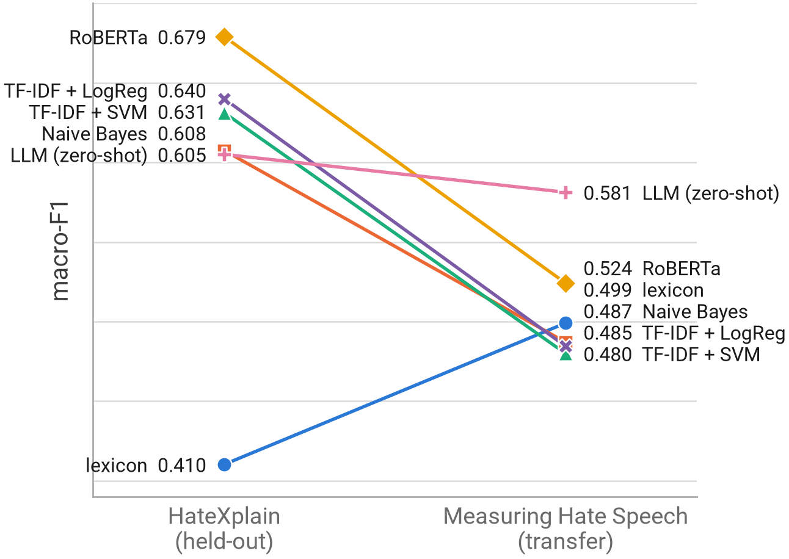
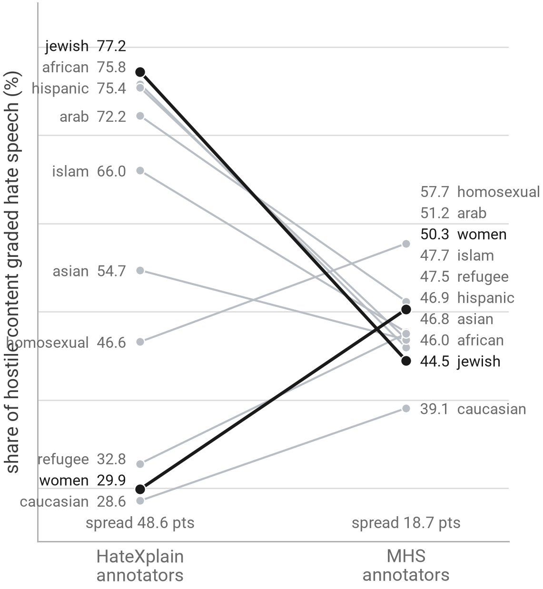
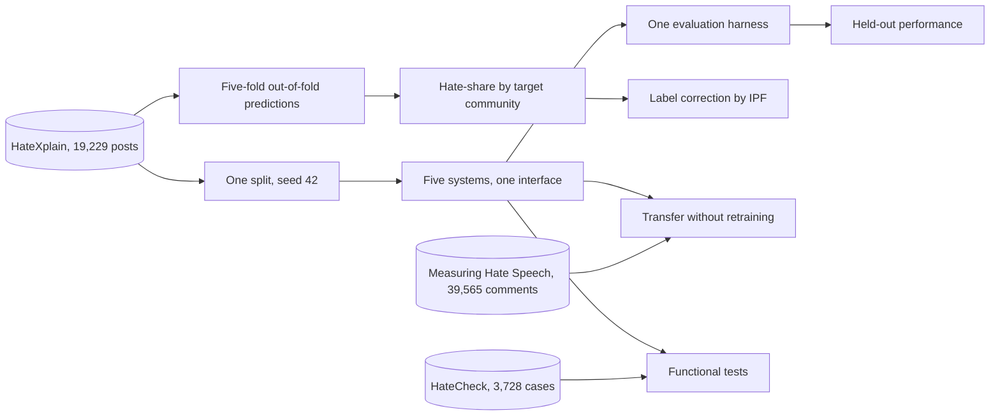
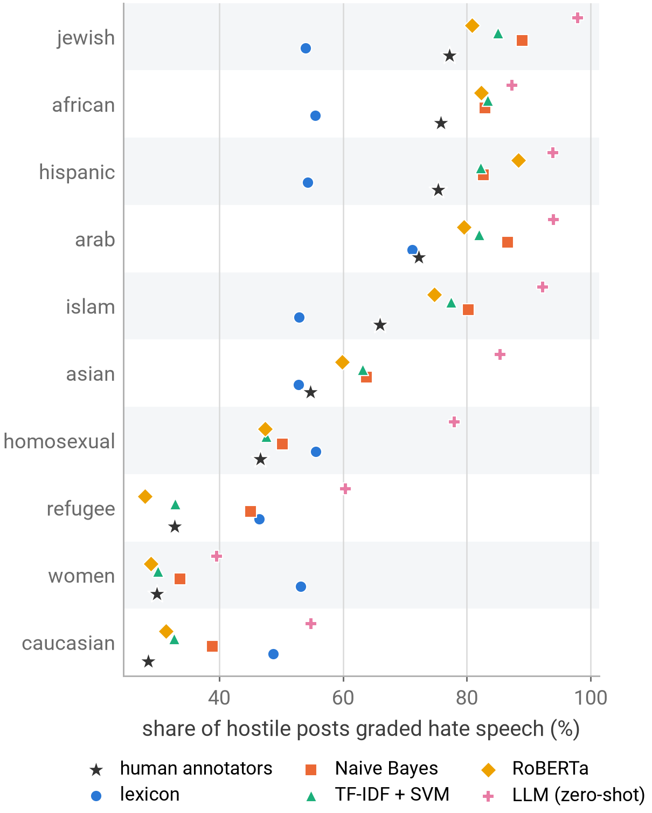

# Hate speech detection across five generations of NLP

The code, results, and full text of my MSc Artificial Intelligence dissertation at Lancaster University, awarded 90%. It compares a rule-based lexicon, naive Bayes, TF-IDF with linear classifiers, a fine-tuned RoBERTa, and a prompted Large Language Model on three-class hate speech detection: hateful, offensive, or normal. All five run through one evaluation harness on one data split. Every measure is broken down by the community a post targets, and every system is tested again on a second corpus it never saw.

**[Read the dissertation (PDF, 59 pages)](docs/dissertation.pdf)**

The headline is a reversal. On the corpus the systems were built from, each generation scores higher than the last. On a second corpus, the ranking largely inverts: every classical system falls below an untrained word list, and the prompted LLM, mid-table on the original benchmark, comes first.



> **Content warning.** The corpora contain hateful and abusive language about real communities. Where this repository quotes posts, slurs are masked.

## Contents

- [Findings](#findings)
- [How the study works](#how-the-study-works)
- [Results](#results)
- [Reproducing the results](#reproducing-the-results)
- [Data](#data)
- [Repository map](#repository-map)
- [Changes since submission](#changes-since-submission)
- [Limitations](#limitations)
- [Citation](#citation)
- [Licence](#licence)

## Findings

1. **Progress is real but front-loaded.** Macro-F1 rises from 0.410 for the rule-based lexicon to 0.679 for RoBERTa, but 19.8 points of that 26.9-point range come from the step from rules to naive Bayes, a method standard in the 1990s. The transformer adds 3.9 points over the best classical system.
2. **The ranking inverts on a second corpus.** Applied without retraining to the Measuring Hate Speech corpus, all three classical systems finish below the untrained lexicon. The LLM barely moves, from 0.605 to 0.581, while RoBERTa drops 15.5 points. How much a system gains from fitting the training data predicts how much it loses when the data changes.
3. **Human annotators grade hostility unevenly by target community.** In HateXplain, 77.2% of hostile posts about Jewish people were graded hate speech rather than merely offensive, against 29.9% for women and 28.6% for white people: a spread of 48.6 percentage points. Neither explicit slur presence (Spearman ρ = +0.139) nor annotator disagreement (ρ = +0.236) accounts for it.
4. **Every learned system reproduces that ordering, and the more capable it is, the less of it comes from the labels.** Equalising the training labels by iterative proportional fitting removes 38.2% of naive Bayes's spread, 30% of the linear classifier's, and 17.2% of RoBERTa's, while RoBERTa's rank agreement with the annotators does not change at all.
5. **The ordering does not replicate, and four careful tests could not have known.** On a second corpus annotated by 7,912 people, the same communities are ordered differently with roughly a third of the spread: Jewish-targeted content moves from first of ten to ninth, women from ninth to third. Four earlier tests had all suggested the ordering was not specific to HateXplain, but all four ran inside HateXplain, and a test inside a corpus cannot detect that the corpus is unusual.
6. **The ordering travels with the model, not the data.** Applied to the second corpus, every learned system ranks the ten communities closer to its training corpus's ordering than to the ordering the second corpus's own annotators produced.
7. **Two failures the benchmark cannot see.** On the HateCheck functional tests, the linear classifier flags 24.4% of neutral statements about Muslims as hate speech and none of the equivalent statements about six other identities. The cause is not that "Muslims" carries hate weight, but that every other identity term is protective evidence and this one is not. Meanwhile the LLM, 7.4 points behind RoBERTa on the benchmark, reaches 0.953 recall at a 0.000 false-alarm rate on the same suite, where RoBERTa reaches 0.156 and 0.040.
8. **Flat is not fair.** The lexicon has the best group-parity scores in the study because it cannot represent severity at all: nine of its ten per-community rates sit in a nine-point band around 50%.



## How the study works



| System | Paradigm | What it is |
| --- | --- | --- |
| Rule-based lexicon | Rules | Tokens ranked by weighted log-odds with a Dirichlet prior, filtered by three stoplists including the names of protected groups. Severity comes from the hit count. |
| Multinomial naive Bayes | Statistical | Raw counts over 10,526 word unigrams, smoothing chosen on validation |
| TF-IDF with a linear SVC or logistic regression | Classical machine learning | Word unigrams and bigrams plus character 3- to 5-grams, balanced class weights |
| RoBERTa-base | Deep learning | Fine-tuned for three epochs with a hand-written training loop, three seeds |
| `claude-haiku-4-5` | Large Language Model | Prompted zero-shot and few-shot with nine hand-written examples, never trained on the corpus, about $16.60 in total |

Every system implements one three-method interface, and one function evaluates them all, so nothing about a model can influence what it is measured on:

```python
class Detector(Protocol):
    name: str
    def fit(self, texts, labels) -> None: ...
    def predict(self, texts) -> list[int]: ...
```

The central measure is **hate-share**: of the posts a rater judges hostile, the share they grade hate speech rather than offensive. It is defined identically for annotators and models, which makes the two directly comparable. The group analysis runs on five-fold out-of-fold predictions over the whole corpus, so that all ten communities have at least 200 hostile posts, while headline performance comes from the held-out test split. The two are never mixed.

To find where a model's ordering comes from, the **label correction** equalises every community's hate-to-offensive ratio in the training data by instance reweighting, fitted jointly by iterative proportional fitting because communities overlap, then retrains and scores against the original labels. The interpretation of the LLM's result was written and committed before the run.

## Results

Held-out test split, 2,883 posts. Intervals are percentile bootstrap with 2,000 resamples, and RoBERTa is the mean of three seeds. The last column applies every system, unchanged, to the Measuring Hate Speech corpus.

| System | Accuracy | Macro-F1 | 95% interval | Hate F1 | Offensive F1 | Normal F1 | Macro-F1 on the second corpus |
| --- | --- | --- | --- | --- | --- | --- | --- |
| Rule-based lexicon | 0.410 | 0.410 | 0.393 to 0.427 | 0.470 | 0.338 | 0.422 | 0.499 |
| Multinomial naive Bayes | 0.623 | 0.608 | 0.590 to 0.625 | 0.695 | 0.453 | 0.674 | 0.487 |
| TF-IDF + linear SVC | 0.646 | 0.631 | 0.615 to 0.648 | 0.721 | 0.478 | 0.695 | 0.480 |
| TF-IDF + logistic regression | 0.648 | 0.640 | 0.624 to 0.657 | 0.722 | 0.515 | 0.683 | 0.485 |
| RoBERTa-base, three seeds | 0.684 | 0.679 ± 0.005 | 0.663 to 0.696 | 0.758 | 0.565 | 0.715 | 0.524 |
| LLM, zero-shot | | 0.605 | | | | | 0.581 |
| LLM, few-shot | | 0.562 | | | | | |

Offensive is the hardest class for every system. It sits in the middle of the severity scale with no vocabulary of its own, which is the boundary this study is about.



| | Naive Bayes | Linear SVC | RoBERTa |
| --- | --- | --- | --- |
| Rank agreement with annotators | +0.952 | +0.988 | +0.903 |
| After label correction | +0.830 | +0.927 | +0.903 |
| Share of the spread removed | 38.2% | 30% | 17.2% |
| Macro-F1 cost of the correction | 0.021 | 0.013 | 0.003 |

`figures_final/` holds every figure in the dissertation, as PDF and PNG, with captions in `captions.md` and `captions_transfer.md`. `results/README.md` describes every results file and the script that writes it.

## Reproducing the results

You need Python 3.12 or newer and [uv](https://docs.astral.sh/uv/). The experiments ran under Python 3.13.9.

```bash
make install     # or: uv sync
make data        # download HateXplain and HateCheck, rebuild the original split
make test        # 263 tests run without PyTorch, 276 with it
make reproduce   # rerun systems 1 to 3 against the archived results
```

Without Make, each target is one `uv run` command; see the [Makefile](Makefile). `make reproduce` retrains the four CPU systems and compares every one of their 2,883 test-set predictions with the archived results:

```text
rule_based_lexicon           macro-F1 archived 0.4103  rerun 0.4103  predictions identical
naive_bayes                  macro-F1 archived 0.6075  rerun 0.6075  predictions identical
tfidf_linear_svc             macro-F1 archived 0.6312  rerun 0.6312  predictions identical
tfidf_logistic_regression    macro-F1 archived 0.6400  rerun 0.6400  predictions identical

All four systems reproduce the archived results exactly.
```

Their out-of-fold predictions over all 19,229 posts reproduce exactly as well. CI repeats the check on every push, under Python 3.13. RoBERTa needs a CUDA GPU and is not bit-reproducible, because cuDNN chooses kernels non-deterministically, which is why it is reported over three seeds. The LLM needs an Anthropic API key and is cached so that interrupted runs do not pay twice. [docs/reproduction.md](docs/reproduction.md) has every step, with timings and costs.

## Data

| Dataset | Role | Licence |
| --- | --- | --- |
| [HateXplain](https://github.com/hate-alert/HateXplain) (Mathew et al., 2021) | Training and in-domain evaluation: 20,148 posts from Twitter and Gab, three annotators each | MIT |
| [Measuring Hate Speech](https://huggingface.co/datasets/ucberkeley-dlab/measuring-hate-speech) (Sachdeva et al., 2022) | Replication and transfer: 39,565 comments, 7,912 annotators | CC BY 4.0 |
| [HateCheck](https://github.com/paul-rottger/hatecheck-data) (Röttger et al., 2021) | Functional tests only: 3,728 hand-built cases | CC BY 4.0 |
| [CNN/DailyMail](https://huggingface.co/datasets/abisee/cnn_dailymail) | An out-of-domain probe, reported as a negative result | Apache 2.0 |

None of the corpora are in the repository; the scripts download them on demand into the gitignored `data/` folder. Result files store post IDs and predictions, not text. The exceptions are the error analysis and false-positive tables in `results_binary/`, which quote HateXplain posts with slurs masked, because an error analysis without its examples is an assertion rather than an analysis. The news-probe results store article IDs only, so no CNN/DailyMail text is redistributed.

## Repository map

```text
hate-speech-detection-nlp-evolution/
├── docs/
│   ├── dissertation.pdf       The dissertation as submitted
│   └── reproduction.md        Every step, with timings and costs
├── figures_final/             The figures in the dissertation, PDF and PNG
├── notebooks/                 Fine-tuning RoBERTa on a free Colab GPU
├── prompts/                   Versioned prompt templates for the LLM
├── results/                   Three-class outputs: one JSON per system, plus every analysis
├── results_binary/            Archived outputs of the earlier binary task
├── scripts/                   Entry points, one per experiment
├── src/
│   ├── harness.py             The shared evaluation function
│   ├── data.py                Loading, majority labels, the split
│   ├── crossval.py            Out-of-fold predictions for the group analysis
│   ├── groups.py              Hate-share, escalation, Wilson intervals
│   ├── reweight.py            Label correction by iterative proportional fitting
│   └── models/                The five systems
├── tests/
├── Makefile
└── pyproject.toml
```

## Changes since submission

The code was submitted as a folder without version control. This repository starts from that upload, in its first commit, and changes it as little as possible:

- **The split rebuilds as it was.** The split was generated while the task was binary and reused for the three-class task, but the saved split was not part of the upload, so a fresh clone built a different test set. `prepare_data` now always stratifies on the binary label, which reproduces the original split exactly. The existing test that guards the reuse caught this.
- **Dependencies are complete.** uv manages them with the original pins. The original `requirements.txt` lacked matplotlib, Pillow, pyarrow, and huggingface_hub, which the figure and transfer scripts need, and stated Python 3.11 although `src/harness.py` needs 3.12.
- **Tooling.** Ruff checks for unused imports and syntax errors, pre-commit runs the checks before each commit, CI runs the tests and the reproduction check, and `scripts/check_reproduction.py` is new. Unused imports and variables were removed and the Colab notebook now clones this repository; nothing else in the code was restyled.
- **The comparison table is complete.** `results/comparison.csv` was regenerated from the archived results and now includes naive Bayes, which the archived copy lacked. `results/comparison.md`, which the upload did not include, was regenerated with it.

A few files that `results/README.md` lists were not in the upload: the `results/figures/` working folder, of which `figures_final/` is the selection used in the dissertation, three plot images, and two hand-written pre-registration notes. The figures can be redrawn with `make_figures` and `make_transfer_figures`.

## Limitations

- Two corpora, both English and both from social media. The transfer result rests on one pair, and the design cannot separate platform, sampling, and annotation as the source of their divergence.
- One system per paradigm. Results attributed to deep learning are about RoBERTa-base, and those attributed to LLMs are about `claude-haiku-4-5` as it behaved between 1 and 3 September 2026.
- Mapping the second corpus's continuous severity score onto three classes is a judgement call. The inversion appears under all three mappings tried, but under one of them the LLM's lead over RoBERTa becomes a tie.
- Ten communities give low statistical power: a Spearman correlation over ten points needs |ρ| ≥ 0.64 to be significant.
- The experiments ran before the code was under version control, so no commit corresponds to any individual result. With the split fix above, the CPU systems reproduce exactly.

## Citation

```bibtex
@mastersthesis{asghar2026hatespeech,
  author = {Mohammad Sami Asghar},
  title  = {The Evolution of {NLP} Methods in Hate Speech Detection: Comparing Rule-Based, Statistical, Machine Learning, Deep Learning and {LLM} Approaches Across Target Groups},
  school = {Lancaster University},
  type   = {{MSc} dissertation},
  year   = {2026},
  note   = {Supervised by Professor Ruslan Mitkov}
}
```

## Licence

The code is released under the MIT licence, see [LICENSE](LICENSE). The corpora are not part of this repository and keep their own licences, listed above.
